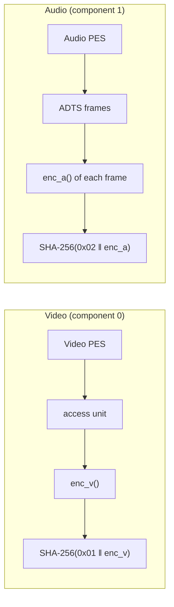
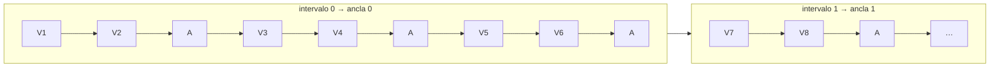
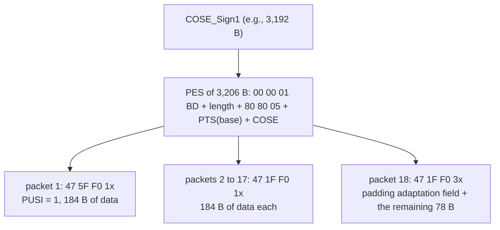
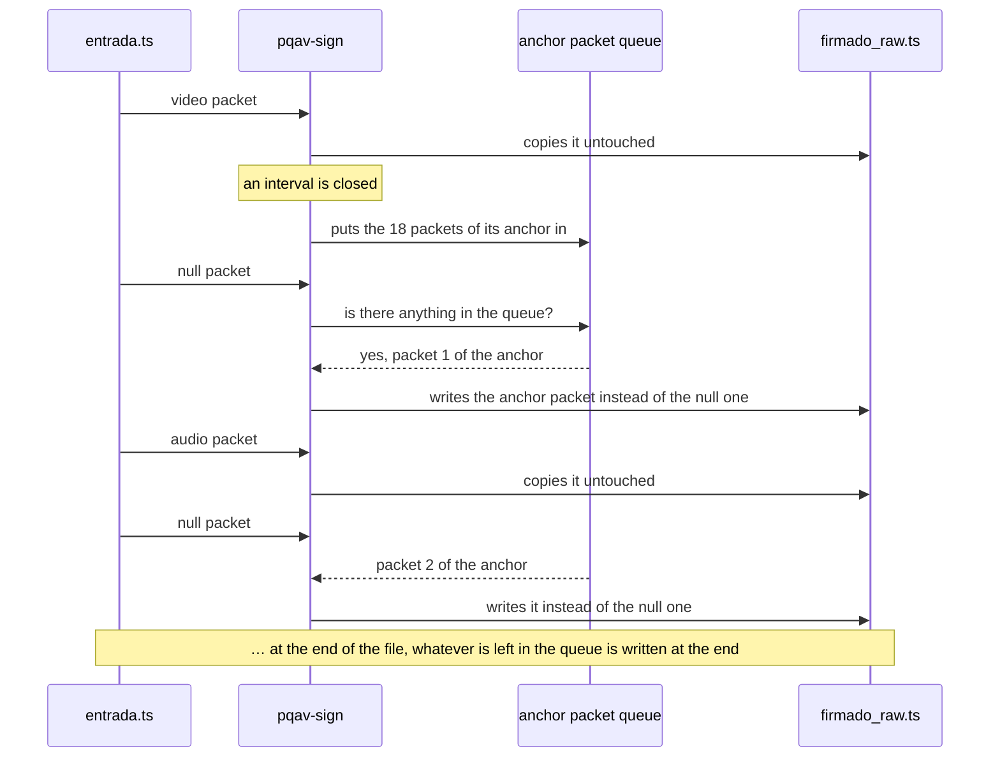
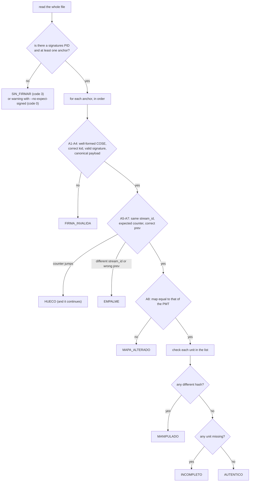

## 1. Fixed values

| Parameter | Value | Comment |
|---|---|---|
| Signatures PID | 0x1FF0 | default value for the `--anchor-pid` option (section 10); tests use 0x1FF0. Supported values: 0x0010 to 0x1FFE |
| Signatures PES `stream_id` | 0xBD (`private_stream_1`) | |
| PMT `stream_type` | 0x06 (PES with private data) | added by TSDuck after signing (section 7.4) |
| `registration_descriptor` `format_identifier` | 0x50514156 ("PQAV") | provisional. On Fri Oct 9, before freezing the format, search "PQAV" in the SMPTE-RA public identifiers list (smpte-ra.org). If it is taken, choose another 4-uppercase-letter one, change it in this table, in section 7.4 and in `scripts/sign.sh`, and note it in the data sheet (06, section E) |
| Video frames per anchor | 6 | the last interval may have fewer (section 4, point 6) |
| Hash | SHA-256 | |
| Signature | ML-DSA-44, deterministic, empty context | RFC 9964 requires the empty context; being deterministic is an MVP decision (section 6) |
| COSE Algorithm | −48 | ML-DSA-44 according to RFC 9964 |
| COSE_Sign1 CBOR tag | 18 | |
| PTS Clock | 90 kHz, 33 bits | |
| AAC frame duration | 1,024 samples = 1,920 PTS ticks at 48 kHz | any other frequency is an error |
| Anchors that can wait in queue | 3 | if more, the signer stops (section 7.3) |
| Maximum `rel` | 2^20 = 1,048,576 ticks (about 11.6 s) | if more, the signer stops (section 4) |

---

## 2. What is signed for each video and audio frame

An unit is what carries its own hash: a video frame or an audio frame. Each unit has three pieces of data: its component (0 = video, 1 = audio in our file), its PTS, and its hash.



### 2.1 H.264 Video

1. An unit is the payload of a video PID PES. `ffmpeg` writes one frame per PES. If a PES has more than one NAL of type 9 (AUD), the program stops with `más de un access unit por PES`.
2. Unit PTS: the PTS from the PES header. If the PES does not have it, the signer stops with `PES de vídeo sin PTS` (the verifier counts it as an unreadable PES, section 12).
3. `enc_v(AU)`, the canonical form of the frame:
   1. Split the frame into NALs by the `00 00 01` start codes. When the code is 4 bytes (`00 00 00 01`), the first `00` belongs to the code, not the previous NAL.
   2. If there is any byte other than 0x00 before the first start code, the program stops with `datos antes del primer código de inicio`.
   3. Remove all trailing 0x00s from each NAL. If a NAL becomes empty, it is ignored.
   4. Check the type (`nal[0] & 0x1F`) and discard type 9 (AUD) and 12 (*filler*).
   5. For each remaining NAL, in the same order: write its length in 4 big-endian bytes followed by its bytes, exactly as they are (without removing emulation prevention `03` bytes).
4. Hash = `SHA-256( 0x01 ‖ enc_v(AU) )`. The leading 0x01 byte ensures that a video frame and an audio frame can never produce the same hash.

Small example. If the PES payload is:

```
00 00 00 01 09 F0 | 00 00 00 01 67 64 00 28 AC | 00 00 01 68 EE 3C 80 | 00 00 01 65 88 84 00 00
   AUD (type 9)          SPS (type 7)               PPS (type 8)            IDR slice (type 5) + 2 zeros
```

then `enc_v` is:

```
00 00 00 05 67 64 00 28 AC   00 00 00 04 68 EE 3C 80   00 00 00 03 65 88 84
length 5    SPS              length 4    PPS           length 3    slice without the two zeros
```

and the hash is `f210c6e5cf4b27796a96271f89134e5905b8f52d2cc94cd5b49779ea6dffcac1`.

The AUD is gone, and the slice has lost its two trailing zeros. A common mistake is removing only one zero, or none, and leaving the length at 4 or 5. Use this same example as an unit test (U4).

### 2.2 AAC Audio in ADTS

1. An unit is an ADTS frame. An audio PES may carry several (`ffmpeg` PES carry about 8); they are traversed one by one by advancing `frame_length` bytes each time, starting from the first byte of the PES payload. Synchronization is not searched for: the first frame starts at byte 0 and each subsequent one starts where the previous one ends.
2. Header rules (how to read each field, in the ADTS header format):

   | Field | Rule | Message if not met |
   |---|---|---|
   | `syncword` | must be 0xFFF. Do not look for the next sync: if the format is broken, it's reported | `ADTS sin sincronía` |
   | `ID` (MPEG-2 or MPEG-4) | not checked or signed | n/a |
   | `layer` | must be 0 | `ADTS con layer distinto de 0` |
   | `protection_absent` | 1 → 7 B header; 0 → 9 B header (the last 2 are a CRC, which is not signed) | n/a |
   | `profile` | is signed | n/a |
   | `sampling_frequency_index` | must be 3 (48 kHz); is signed | `audio que no es de 48 kHz` |
   | `channel_configuration` | is signed | n/a |
   | `frame_length` | used to advance; is not signed (deduced from data). Must be at least the header length and not exceed the end of the PES | `trama ADTS cortada` |
   | `adts_buffer_fullness`, `private_bit`, `original_copy`, `home`, *copyright* bits | not signed | n/a |
   | `number_of_raw_data_blocks_in_frame` | must be 0 | `ADTS con varios bloques por trama` |

   If there are fewer than 7 bytes left at the end of the PES, it's also `trama ADTS cortada`.
3. PTS of frame k (k = 0 for the first in the PES) = `(PTS_PES + 1920·k) mod 2^33`. An audio PES without PTS: the signer stops with `PES de audio sin PTS`.
4. `enc_a(frame)` = 3 bytes `[profile, sampling_frequency_index, channel_configuration]` (each in one byte, with its numerical value) followed by the frame data (from the end of the header up to `frame_length`).
5. Hash = `SHA-256( 0x02 ‖ enc_a(frame) )`.

Example: a stereo AAC LC frame at 48 kHz has `profile` 1, `sampling_frequency_index` 3, and `channel_configuration` 2, so `enc_a` starts with `01 03 02` and continues with the data. The complete header decoded field by field is in the ADTS header decoding.

### 2.3 Subtracting PTS without mistakes

PTS values are 33 bits long and wrap around. To subtract, this function is always used:

```
dif(a, b) = ((a − b + 2^32) mod 2^33) − 2^32
```

Signed result, in 90 kHz ticks, between −2^32 and 2^32 − 1. Examples that must pass in your tests: `dif(5, 2^33 − 5) = 10` and `dif(2^33 − 5, 5) = −10`. The `mod` is always the positive one (in Rust, `rem_euclid`).

## 3. Component map

Derived from the PMT:

1. Traverse the stream loop of the PMT in order.
2. Skip the signatures entry: the one with `stream_type` 0x06 and a `registration_descriptor` (tag 0x05) with "PQAV", or the one with the `--anchor-pid` PID.
3. Each remaining entry must be H.264 video (0x1B) or AAC audio (0x0F). If there is anything else, the program stops with `tipo de flujo no admitido`. There must be exactly one video and at most one audio; otherwise, `la PMT no tiene un vídeo H.264` or `la PMT tiene más de un vídeo o más de un audio`.
4. For each entry, form the tuple `[stream_type, language, audio_type]`:
   - `language`: the 3 letters of the first language descriptor (tag 0x0A) of that entry, or `""` if it has none (or if the descriptor is less than 3 bytes);
   - `audio_type`: the byte that follows those 3 letters, or 0 if there is none.
5. The component index is the position in this list, starting at 0.

With the test file it produces `[[27, "", 0], [15, "spa", 0]]`: 0 is video and 1 is audio.
With `solo_video.ts` it produces `[[27, "", 0]]`.

The PID is not signed. Thus, changing the PID of a stream (many multiplexers do this) does not break the signature. What is signed is the type, the language, and the order: changing "spa" to "eng" is detected.

Video and audio packets that arrive before the first valid PMT cannot be assigned to any component and are ignored, both in the signer and in the verifier. This doesn't happen with `ffmpeg` files: the PAT and PMT are the first packets.

---

## 4. How units are grouped into intervals




1. The signer reads the file in order and adds each unit to the interval that is open at the moment its PES ends. A PES ends when the next packet of that PID with PUSI = 1 arrives, or at the end of the file.
2. When it is going to add a video unit and the open interval already has 6 video units, it first closes the interval (builds its anchor) and opens a new one. The new unit goes to the new one. That is, an interval is closed when the PES of the 7th video unit ends.
   Audio frames are always added to the interval that is open at that moment, and all frames of the same PES go to the same interval.
3. At the end of the file: finish all pending PES (first video and then audio) and close the open interval. That is the last anchor, and it is the only one with `final = true`.
4. Interval base: the lowest PTS of its units. It is calculated like this, so that it works even if the PTS wraps around: `base = (pts_0 + min_i dif(pts_i, pts_0)) mod 2^33`, where `pts_0` is the PTS of the first unit in the interval.
5. Relative PTS of each unit: `rel = dif(pts, base)`. It is always ≥ 0. If any exceeds 2^20 (about 11.6 s), the program stops with `intervalo demasiado largo`.
6. The last interval may have fewer than 6 video units if the number of frames in the file is not a multiple of 6. It is valid and verified just like the others. With the 60 s file this doesn't happen (1,500 = 250 × 6); with the 10 s sample (250 frames) there are 42 anchors, 41 with 6 frames and the last one with 4.

Why the minimum PTS is used and not the first one: with *B-frames* (due to B-frames), some frame of the 6 may have a lower PTS than the first one that arrived.

With the test file (60 s, 25 fps) there are 250 anchors: 1,500 frames ÷ 6.

Audio is not distributed evenly. An `ffmpeg` audio PES carries about 8 frames (about 170 ms) and doesn't finish until the next one starts, about 340 ms after the PTS of its first frame. That is why each interval (240 ms) receives one or two audio PES, i.e., 8 or 16 frames (11.25 on average); the first interval is usually left without audio; and the base is usually the PTS of an audio frame, earlier than those of the video frames of the same interval. With all that, `rel` does not exceed about 55,000 ticks. It is the expected behavior: the verifier searches for each unit by its PTS and does not care in which interval it travels.

Example of base and `rel`. If an interval receives, in this order, units with PTS 133,200 (video), 126,000 (video), 129,600 (video), and 124,080 (audio), then `pts_0` = 133,200, the minimum of the differences is −9,120, the base is 124,080, and the `rel` values are 9,120, 1,920, 5,520, and 0.

---

## 5. Anchor content (CBOR payload)

A CBOR map of 7 pairs, with the keys in order 1 to 7, integers always in their shortest form, and without indefinite lengths:

| Key | Name | CBOR Type | Approx. size | What it contains |
|---:|---|---|---:|---|
| 1 | `version` | integer | 1 B | always 1 |
| 2 | `stream_id` | bytes | 16 B | random; one for each execution of `pqav-sign` (a "session") |
| 3 | `counter` | integer | 1–2 B (up to 3 above 255) | 0 in the first anchor; goes up by 1 |
| 4 | `prev` | bytes | 32 B | SHA-256 of the complete bytes of the COSE_Sign1 of the previous anchor. In the first one, 32 zero bytes |
| 5 | `components` | list of `[integer, text, integer]` | ≈ 14 B | the map from section 3 |
| 6 | `units` | list of `[integer, integer, bytes]` | 39 B per unit (37 if `rel` = 0; 41 if `rel` ≥ 65,536) | `[component, rel, hash]` in the order they entered the interval |
| 7 | `final` | boolean | 1 B | `true` only in the last anchor |


### 5.1 Example of the first bytes of a payload

```
A7                                   map of 7 pairs
  01 01                              1: 1                       (version)
  02 50 <16 bytes>                   2: bstr of 16              (stream_id)
  03 00                              3: 0                       (counter)
  04 58 20 <32 zero bytes>           4: bstr of 32              (prev)
  05 82                              5: list of 2 components
     83 18 1B 60 00                     [27, "", 0]             video
     83 0F 63 73 70 61 00               [15, "spa", 0]          audio
  06 92                              6: list of 18 units        (the number varies)
     83 00 19 4E 20 58 20 <32 B>        [0, 20000, hash]        one video unit
     83 01 19 51 40 58 20 <32 B>        [1, 20800, hash]        one audio unit
     …
  07 F4                              7: false                   (final)
```

Notice that 27 needs two bytes (`18 1B`), because only values less than 24 fit in one. It is a detail that must be correct so that the signer and the verifier write the same thing.

How the bytes of `counter` and `rel` change according to the value:

| Value | CBOR Bytes | Size |
|---|---|---:|
| `counter` 0 to 23 | `00` to `17` | 1 B |
| `counter` 24 to 255 | `18 18` to `18 FF` | 2 B |
| `counter` 256 to 65,535 | `19 01 00` … | 3 B |
| `rel` 0 | `00` | 1 B (the entry is 37 B) |
| `rel` 1,920 | `19 07 80` | 3 B (39 B) |
| `rel` 3,600 | `19 0E 10` | 3 B (39 B) |
| `rel` 65,536 or more | `1A 00 01 00 00` … | 5 B (41 B) |


A complete entry of `units`, that of the video unit from the example in section 2.1 with `rel` = 20,000:

```
83                                   list of 3
00                                   component 0 (video)
19 4E 20                             rel = 20,000
58 20                                bstr of 32 bytes
F2 10 C6 E5 CF 4B 27 79 6A 96 27 1F 89 13 4E 59
05 B8 F5 2D 2C C9 4C D5 B4 97 79 EA 6D FF CA C1   the hash from the example in section 2.1
```

39 bytes in total: 1 + 1 + 3 + 2 + 32.

### 5.2 Expected sizes

| | Video only | Video + audio (11.25 AAC frames per anchor on average) |
|---|---:|---:|
| Payload | 302 B (301 while `counter` < 24) | ≈ 748 B on average (≈ 620 B with 8 frames, ≈ 930 B with 16) |
| Complete COSE_Sign1 | 2,746 B (2,745) | ≈ 3,192 B on average |


The COSE always measures the payload plus 2,444 bytes (with the single exception described in section 6, which doesn't occur with these files). If your averages deviate by more than 5%, there is an error.
The breakdown is in the expected sizes.

---

## 6. The COSE_Sign1 envelope

```
D2                                     tag 18 (COSE_Sign1)
84                                     list of 4 elements
  44 A1 01 38 2F                       1. protected header: bstr containing {1: -48}
  A1 04 48 <8 bytes>                   2. unprotected header: {4: kid}
  59 LL LL <payload>                   3. payload: bstr with the map from section 5
  59 09 74 <2,420 bytes>               4. signature ML-DSA-44
```

- `kid` = the first 8 bytes of `SHA-256(public key)`, with the public key being the 1,312 bytes of the `.pub` file.
- `LL LL` is the payload length in 2 bytes: `01 2E` for 302 B, `02 EC` for 748 B. With the files in this guide, the payload is always between 256 and 65,535 bytes, so it always goes with `59`. Only the last interval of a file without audio, if it has 4 frames or less, goes below 256 B: then the length goes in 1 byte (`58 LL`) and that COSE measures the payload plus 2,443. `minicbor` chooses the single form; nothing needs to be programmed separately.
- The 2,444 bytes that the COSE adds to the payload are: `D2 84` (2), protected header (5), unprotected header with the `kid` (11), payload header `59 LL LL` (3), signature header `59 09 74` (3), and the signature (2,420).
- The signature is calculated over this CBOR list, which wraps the payload (`Sig_structure`, section 2.4 of RFC 9052):

  ```
  84                                   list of 4
    6A 53 69 67 6E 61 74 75 72 65 31   "Signature1"
    44 A1 01 38 2F                     the protected header, same as above
    40                                 empty bstr (external data: none)
    59 LL LL <payload>                 the payload
  ```

  With a payload of 302 B, the `Sig_structure` starts with
  `84 6A 53 69 67 6E 61 74 75 72 65 31 44 A1 01 38 2F 40 59 01 2E` and measures 323 bytes.

- ML-DSA-44 signature with empty context, as required by RFC 9964, and in its deterministic variant. RFC 9964 also supports the randomized variant; we use the deterministic one so that the same key and the same payload always give the same bytes, which makes testing easier. This is what `Signer::try_sign` does in `ml-dsa` 0.1.1.

## 7. How the anchor travels within the TS



### 7.1 The PES

| Field | Value |
|---|---|
| start | `00 00 01` |
| `stream_id` | `BD` |
| `PES_packet_length` | 3 + 5 + COSE length (always fits in 16 bits) |
| *flags* 1 | `80` |
| *flags* 2 | `80` (PTS only) |
| `PES_header_data_length` | `05` |
| PTS | the interval base (section 4, point 4), in 5 bytes with the prefix `0010` |
| data | the COSE_Sign1 |


Example: with a 3,192 B COSE and base 126,000, the first 14 bytes of the PES are
`00 00 01 BD 0C 80 80 80 05 21 00 07 D8 61` (`0C 80` = 3,200 = 3 + 5 + 3,192).

### 7.2 The TS packets

- PID 0x1FF0. Header of the first packet: `47 5F F0 1c` (`c` = continuity counter). For the others: `47 1F F0 1c`.
- The continuity counter starts at 0 and goes up by 1 in each packet (0 to 15 and back to 0). It does not reset between anchors.
- The last packet of each PES pads with an adaptation field. If there are `r` bytes left to write (between 1 and 183):
  - header `47 1F F0 3c` (`3` = adaptation field + payload);
  - adaptation field length `L = 183 − r`;
  - if `L = 0`: just the byte `00`;
  - if `L ≥ 1`: the byte `L`, a flags byte `00`, and `L − 1` `FF` bytes;
  - then, the remaining `r` bytes.

  If there are exactly 184 bytes left, the last packet is normal (`47 1F F0 1c`) and carries no padding. This happens with all video-only anchors with `counter` ≥ 24: their PES measures 2,760 B, exactly 15 × 184. Those with `counter` < 24 measure 2,759 B (15 packets, the last one with `L` = 0).
- Never PCR, never scrambled.

Checking table (used by test U12):

| COSE | PES | Packets | Last packet (counter starting at 0) |
|---:|---:|---:|---|
| 3,192 B | 3,206 B | 18 | `47 1F F0 31`, `L` = 105, then 78 B of data |
| 2,746 B | 2,760 B | 15 | `47 1F F0 1E`, no adaptation field |
| 2,929 B | 2,943 B | 16 | `47 1F F0 3F 00`, `L` = 0, then 183 B of data |
| 2,747 B | 2,761 B | 16 | `47 1F F0 3F B6 00` + 181 `FF`, `L` = 182, then 1 B of data |


### 7.3 Null substitution



Rules:

- Every non-null packet is copied without touching a single bit.
- A null is substituted if there is something in the queue; otherwise, it is copied.
- The output file has the same number of packets as the input file, plus those remaining in the queue at the end (at a minimum, those of the last anchor, which is closed at the end of the file). `pqav-sign` tells how many it appended (`appended_packets`, section 11.1).
- The queue counts anchors, not packets: an anchor is "waiting" as long as it has any packet left to write. Right after putting a new anchor into the queue, if there are more than 3 waiting (that is, 4 or more), the signer stops with `hueco de nulos insuficiente` and indicates the null bitrate measured up to that point. At the end of the file this check is not done: what is left is appended at the end.

### 7.4 Declaring the PID in the PMT

`pqav-sign` does not touch the PMT. After signing, TSDuck adds the entry:

```bash
tsp -I file firmado_raw.ts \
    -P pmt --add-pid 0x1FF0/0x06 --add-pid-registration 0x1FF0/0x50514156 \
    -O file firmado.ts
```

It doesn't break anything because the signed map excludes the signatures entry (section 3, step 2). TSDuck does not change the PMT version (`--increment-version` would be needed), so it remains 0. The resulting PMT, byte for byte, is in the PMT structure.

---

## 8. How the verifier decides



The drawing summarizes the order of checks. In the program, an anchor that passes A1 to A4 is checked entirely (A5 to A8 and all its units) even if some fail, and the interval verdict is the one with the highest priority of those that come out (section 8.3). This way its units are marked as covered and do not come out as `NO_FIRMADA`.

### 8.1 Checks for each anchor

| # | Check | If it fails | `detail` in JSON (section 11.2) |
|---|---|---|---|
| A1 | Well-formed COSE: tag 18, list of 4, protected header exactly `A1 01 38 2F`, unprotected header `{4: 8 B kid}`, 2,420 B signature, nothing leftover, and rewriting the envelope gives the same bytes. Also fails if the anchor's PES cannot be read or has no PTS | `FIRMA_INVALIDA` | `COSE mal formado` or `PES de ancla ilegible` |
| A2 | the `kid` matches that of the public key passed to it | `FIRMA_INVALIDA` | `kid desconocido` |
| A3 | the ML-DSA-44 signature is valid over the `Sig_structure` (if the signature doesn't even decode, A3 also fails) | `FIRMA_INVALIDA` | `firma no válida` |
| A4 | the payload is canonical: decoding it and re-encoding it gives the same bytes; keys 1 to 7 are present and no others; `version` = 1; 16 B `stream_id`, 32 B `prev`, each hash 32 B, each language 0 or 3 characters; each `comp` is less than the number of components; nothing is leftover | `FIRMA_INVALIDA` | `carga no canónica` |
| A5 | the `stream_id` is the same as the first valid anchor | `EMPALME` | `stream_id distinto` |
| A6 | the `counter` is the expected one (section 8.2, point 5) | if it's greater: `HUECO` (missing anchors) and it continues; if it's smaller: `EMPALME` | `contador hacia atrás` (only if it's smaller) |
| A7 | `prev` = SHA-256 of the previous COSE. Only checked if there was no gap and if the previous anchor passed A1–A4 | `EMPALME` | `prev no coincide` |
| A8 | `components` is equal to the calculated map of each PMT version that appears in the file | `MAPA_ALTERADO` | `mapa distinto del de la PMT` |


If several from A5 to A7 fail, `detail` carries the first one in that order. If an interval comes out `MANIPULADO`, `INCOMPLETO`, or `AUTENTICO`, `detail` is `null`.

Why A7 has that exception: if the previous anchor arrived corrupted (test P12), its hash is no longer the one that was signed, and the next one would come out as `EMPALME` without being one. The problem is already marked in the previous one; it shouldn't be counted twice.

### 8.2 Checking units

1. The verifier calculates all received units (component, PTS, and hash) with the same rules from section 2.
2. For each unit listed in an anchor that passed A1–A4, the expected PTS is `(PES PTS of the anchor + rel) mod 2^33`. It searches for a received unit with that component and that PTS:
   - if it exists and the hash matches: OK;
   - if it exists and the hash does not match: MODIFICADA;
   - if it does not exist: FALTA.
3. Received units that do not appear in any valid anchor are NO_FIRMADA. If two units arrive with the same component and the same PTS, only the first one is searched for; the other remains as NO_FIRMADA.
4. A video or audio PES that cannot be read (cut, with a broken ADTS header, without PTS) does not stop the verifier: it produces no units, is counted in `unreadable_pes`, and the ones the anchor expected come out as FALTA. The same with a broken anchor PES: it comes out as `FIRMA_INVALIDA`. The verifier only stops with `ERROR_ENTRADA` if it does not understand the file in general (section 10.6).
5. Expected counter. An invalid anchor still occupies its counter number, so the expected one for a valid anchor is that of the last valid one plus 1, and plus 1 for each invalid anchor that has arrived between the two. For the first valid anchor, the expected is the number of invalid anchors that arrived before it (0 if the first one arrives well). Thus, if someone cuts the beginning of the file, the first anchor that remains carries a counter greater than the expected one and comes out as `HUECO`. The number of missing anchors (received counter minus expected) goes in `gap_before` (section 11.2).

### 8.3 Verdict of each interval (the one with the highest priority wins)

| Priority | Verdict | When |
|---:|---|---|
| 1 | `FIRMA_INVALIDA` | any of A1 to A4 fails |
| 2 | `EMPALME` | A5, A6 (backwards), or A7 fails |
| 3 | `MAPA_ALTERADO` | A8 fails |
| 4 | `MANIPULADO` | any unit is MODIFICADA |
| 5 | `INCOMPLETO` | any unit is missing and none is MODIFICADA |
| 6 | `AUTENTICO` | all good |


`HUECO` is not an interval verdict: the interval whose counter jumps is judged with this table like any other, and the gap is noted in `gap_before` and in the global reasons.

### 8.4 Global verdict and exit code

| Global | When | Code |
|---|---|---:|
| `AUTENTICO` | all intervals `AUTENTICO`, no `HUECO`, no `NO_FIRMADA` and there is a valid anchor with `final = true` | 0 |
| `RECHAZADO` | any other case with at least one received anchor; reasons are listed | 1 |
| `ERROR_ENTRADA` | the file does not meet the README (What it is not) (e.g., audio at 44.1 kHz in the PMT, two programs) or cannot be read; full list in section 10.6 | 2 |
| `SIN_FIRMAR` | there is no signatures PID or no anchor arrives | 3 |
| `SIN_FIRMAR` with `--no-expect-signed` | same, but the user has said the source might not sign: just warns | 0 |


The reasons (`reasons` in the JSON) are, without repeating and in this order, those that appear from this list: `FIRMA_INVALIDA`, `EMPALME`, `MAPA_ALTERADO`, `MANIPULADO`, `INCOMPLETO` (interval verdicts other than `AUTENTICO`), `HUECO`, `NO_FIRMADA` (if there is any unsigned unit) and `SIN_FINAL` (if there is no valid anchor with `final = true`). With `AUTENTICO`, `SIN_FIRMAR` and `ERROR_ENTRADA`, the list is empty.

Example of how it is built: if interval 10 comes out `FIRMA_INVALIDA`, 11 `AUTENTICO`, and there are 14 unsigned units, the reasons are `["FIRMA_INVALIDA", "NO_FIRMADA"]`, in that order, even if the unsigned units were detected earlier.

### 8.5 Output example

The values are illustrative, but they have the shape you will see with the test file (section 4). The exact format of each line is in section 10.5.

```
#0000 base=00000126000 video 6/6 audio 0/0 AUTENTICO
#0001 base=00000124080 video 6/6 audio 8/8 AUTENTICO
#0002 base=00000139440 video 6/6 audio 16/16 AUTENTICO
...
#0141 base=00003150000 video 6/6 audio 5/8 MANIPULADO  audio: 3 modificadas (pts 3150000, 3151920, 3153840)
...
RESULTADO: RECHAZADO  intervalos=250 autenticos=245 manipulados=5  motivos: MANIPULADO
```

---

## 9. Limits to be stated out loud

They go exactly as is into the MVP README and the data sheet (06, section E):

- It is a recorded file, not a live stream. It says nothing about when it was recorded.
- An attacker can remove all signatures. The verifier detects this (`SIN_FIRMAR`) only because, by default, it expects the source to sign. With `--no-expect-signed` it just warns (test P10c).
- Identical frames from another signed session have the same hash. What detects the splice is the `stream_id` (A5) and `prev` (A7, the `prev` of the first anchor of the other session is not the hash of the previous anchor). The counter does not detect it: in P8 it remains in order.
- The private key is in a file, without any protection.
- Only H.264 and AAC at 48 kHz, one program.
- The signature is deterministic so that the tests are reproducible. In the project design, the device signs with the variant with added randomness (*hedged*; the README (What it is not).6 of `docs/03` of the dossier). Both are valid ML-DSA and the verifier does not distinguish one from the other.

---

## 10. Interface of the three programs

Options are read with `clap` (using clap). All three accept `--help` and `--version`. A PID number can be written in hexadecimal (`0x1FF0`) or decimal (`8176`). If a mandatory option is missing or there is an extra one, `clap` prints the usage and the program exits with code 2.

### 10.1 `pqav-keygen`

| Option | Default value | What it does |
|---|---|---|
| `--out <prefix>` | mandatory | writes `<prefix>.seed` and `<prefix>.pub`. Example: `--out testdata/fuente` yields `testdata/fuente.seed` and `testdata/fuente.pub` |
| `--force` | disabled | overwrites files if they already exist. Without it, if either of the two exists, it stops with `el fichero … ya existe` and touches nothing |


Console output if everything goes well (code 0), with the `kid` in hexadecimal, 16 characters:

```
semilla:       testdata/fuente.seed
clave pública: testdata/fuente.pub
kid:           <16 hexadecimal characters>
```

### 10.2 Key files

| File | Exact content | Size | Permissions |
|---|---|---:|---|
| `.seed` | the 32-byte seed in lowercase hexadecimal (64 characters) and a newline `\n` | 65 B | 0600 (only your user) |
| `.pub` | the 1,312 bytes of the ML-DSA-44 public key exactly as given by `encode()`, in binary, without header or newline | 1,312 B | the normal ones (0644) |


When reading:

- `.seed`: read as text, trailing spaces and newlines are removed (so a seed with `\r\n` is also valid), and what remains must be exactly 64 hexadecimal characters (uppercase or lowercase). If not, `semilla inválida`. The private key is rebuilt with `SigningKey::from_seed`: the expanded key is never saved.
- `.pub`: must measure exactly 1,312 bytes. If not, `clave pública inválida`.
- The `kid` is not saved in any file: it is always calculated as the first 8 bytes of the SHA-256 of the 1,312 bytes of the public key. The signer calculates it from the key it rebuilds from the seed.

To view a key by hand: `cat testdata/fuente.seed` shows the 64 characters; `stat -c %s testdata/fuente.pub` must yield `1312`; and `sha256sum testdata/fuente.pub | cut -c1-16` gives the `kid`.

### 10.3 `pqav-sign`

| Option | Default value | What it does |
|---|---|---|
| `--key <file.seed>` | mandatory | seed of the private key |
| `--in <file.ts>` | mandatory | input TS; is not modified |
| `--out <file.ts>` | mandatory | output TS (normally `…_raw.ts`, without the PMT entry; added by `sign.sh`). If it exists, it is overwritten |
| `--anchor-pid <PID>` | `0x1FF0` | PID where the anchors go; must be between 0x0010 and 0x1FFE |
| `--bitrate <bit/s>` | `8000000` | bitrate of the input TS. Only used to convert the insertion delay to milliseconds and the null bitrate to kb/s |
| `--stats <file.json>` | none | writes the statistics from section 11.1. Without this option JSON is not written |
| `--debug-unit <comp>:<pts>` | none | optional, for debugging only: prints to standard error the hash of that unit (for debugging). Tests do not use it |


Console output if everything goes well (code 0), a single line:

```
pqav-sign: <anchors> anclas; <n> unidades de vídeo y <n> de audio; <n> paquetes leídos; <n> nulos sustituidos; <n> añadidos al final
```

With `entrada.ts` it should say 250 anchors, 1500 video units, about 2812 audio units, about 319000 packets read and between 17 and 22 appended at the end (those of the last anchor; it usually occupies more packets than the others because it also receives all the audio left pending at the end of the file). The program writes the numbers without thousands separators.

### 10.4 `pqav-verify`

| Option | Default value | What it does |
|---|---|---|
| `--pub <file.pub>` | mandatory | public key of the source |
| `--in <file.ts>` | mandatory | TS to be verified |
| `--anchor-pid <PID>` | `0x1FF0` | anchors PID if the PMT does not declare one with the "PQAV" registration. If the PMT declares it, the PMT rules (that's why P2 works) |
| `--no-expect-signed` | disabled | if there are no signatures, exits with code 0 and a warning instead of code 3 |
| `--json <file.json>` | none | writes the result from section 11.2. Also written with `SIN_FIRMAR` and with `ERROR_ENTRADA` (except for `clap` usage errors) |
| `--quiet` | disabled | prints only the `RESULTADO:` line |
| `--debug-unit <comp>:<pts>` | none | optional, for debugging only: prints to standard error the calculated hash of that unit. Tests do not use it |


### 10.5 Format of the verifier's text output

Everything goes to standard output. One line per interval, in order of arrival, and a final line.

Interval with valid anchor:

```
#<index, 4 digits> base=<base, 11 digits> video <ok>/<total> audio <ok>/<total> <VERDICT>[  <detail>]
```

- `<ok>` counts the listed units that have come out OK; `<total>`, the listed ones. With `video 6/6 audio 5/8`, the anchor lists 6 frames and 8 frames and 3 frames are not ok.
- The detail, separated by two spaces, only appears if there is something to report, in this order and separated by `; `:
  - `detail` from section 8.1 if any (e.g., `stream_id distinto`);
  - `HUECO: faltan <n> anclas antes de esta` if `gap_before` > 0;
  - `<vídeo|audio>: <n> modificadas (pts a, b, c)` with at most the first 3 PTS;
  - `<vídeo|audio>: <n> faltan (pts a, b, c)`, same.

Interval with `FIRMA_INVALIDA` (it is not known what it lists):

```
#0010 base=00001326000 FIRMA_INVALIDA  firma no válida
```

If the anchor PES had no PTS, `base=-----------` (11 hyphens).

Final line:

```
RESULTADO: <GLOBAL>  intervalos=<n> autenticos=<n> [firmas_invalidas=<n>] [empalmes=<n>] [mapas_alterados=<n>] [manipulados=<n>] [incompletos=<n>] [no_firmadas=<n>]  motivos: <comma-separated list, or "ninguno">
```

The counters in brackets only appear if they are greater than 0. With `SIN_FIRMAR` the line is
`RESULTADO: SIN_FIRMAR  no hay firmas en el fichero`, and with `--no-expect-signed` it is preceded by
`AVISO: el fichero no lleva firmas y se ha pedido no exigirlas` (except with `--quiet`, which only prints the `RESULTADO:` line; the exit code, 0, already says it is a warning). With `ERROR_ENTRADA` it is
`RESULTADO: ERROR_ENTRADA  <message from section 10.7>`.

### 10.6 Exit codes

| Program | 0 | 1 | 2 | 3 |
|---|---|---|---|---|
| `pqav-keygen` | keys written | n/a | usage error, file already exists, error writing | n/a |
| `pqav-sign` | file signed | n/a | usage error or any error from section 10.7 (output file cannot be trusted) | n/a |
| `pqav-verify` | `AUTENTICO`, or `SIN_FIRMAR` with `--no-expect-signed` | `RECHAZADO` | `ERROR_ENTRADA`, usage error, or `--json` could not be written | `SIN_FIRMAR` |


For `pqav-verify`, `ERROR_ENTRADA` occurs in these cases and only in these: the file or the public key cannot be read; the public key does not measure 1,312 B; the file does not measure a multiple of 188 bytes or some packet does not start with 0x47; there is no valid PAT or PMT; the PAT has more than one program; the first valid PMT has an unsupported stream type, no video, or more than one video or audio. Everything else (broken PES, broken anchors, sections with bad CRC, packets with transport error) is handled within the verdict.

### 10.7 Error messages (closed list)

All errors go to standard error with the form `<program>: error: <message>` and, when known, ` (paquete <n>)` at the end, with `n` counted from 0. In the signer all end with code 2. In the verifier, those in the "verifier" column produce `ERROR_ENTRADA` (code 2); those that say "verdict" do not stop the program.

| Message | When it occurs | Signer | Verifier |
|---|---|---|---|
| `no se puede leer <path>: <detail>` | the file does not exist or there is no permission | 2 | 2 |
| `no se puede escribir <path>: <detail>` | the folder does not exist or there is no permission | 2 | 2 (only `--json`; it is not `ERROR_ENTRADA`: the verdict is already calculated and printed anyway) |
| `el fichero <path> ya existe (usa --force para sobrescribirlo)` | `pqav-keygen` without `--force` | n/a | n/a |
| `semilla inválida en <path>: tienen que ser 64 caracteres hexadecimales` | section 10.2 | 2 | n/a |
| `clave pública inválida en <path>: mide <n> bytes y tiene que medir 1312` | section 10.2 | n/a | 2 |
| `el fichero no mide un múltiplo de 188 bytes` | size of the TS | 2 | 2 |
| `paquete sin sincronía` | a packet does not start with 0x47 | 2 | 2 |
| `paquete con error de transporte` | `transport_error_indicator` bit is 1 | 2 | verdict: the packet is ignored |
| `campo de adaptación inválido` | `adaptation_field_length` exceeds the packet | 2 | verdict: the packet is ignored |
| `CRC incorrecto en la tabla del PID 0x<pid>` | a PAT or PMT section with bad CRC | 2 | verdict: the section is ignored |
| `sección mal formada en la tabla del PID 0x<pid>` | PAT or PMT lengths that do not add up | 2 | verdict: the section is ignored |
| `tabla inesperada: table_id 0x<id> en la tabla del PID 0x<pid>` | a section of another type arrives on the PAT or PMT PID | 2 | verdict: the section is ignored |
| `no se ha encontrado la PAT o la PMT` | the file ends without a valid PAT and PMT | 2 | 2 |
| `el MVP solo admite un programa` | the PAT lists more than one program (not counting 0) | 2 | 2 |
| `tipo de flujo no admitido: 0x<type> en el PID 0x<pid>` | section 3, step 3 | 2 | 2 |
| `la PMT no tiene un vídeo H.264` | section 3, step 3 | 2 | 2 |
| `la PMT tiene más de un vídeo o más de un audio` | section 3, step 3 | 2 | 2 |
| `la PMT cambia a mitad del fichero` | a later PMT gives another component map or other video or audio PIDs | 2 | verdict: A8 |
| `el fichero ya está firmado` | the PMT has an entry with "PQAV" or with the `--anchor-pid` PID, or some packet uses that PID (also happens with a `firmado_raw.ts`) | 2 | n/a |
| `PES sin código de inicio` | the PES does not start with `00 00 01` | 2 | verdict: unreadable PES |
| `PES demasiado corto` | the PES does not reach its complete header | 2 | verdict: unreadable PES |
| `PES de vídeo sin PTS`, `PES de audio sin PTS` | sections 4.1 and 4.2 | 2 | verdict: unreadable PES |
| `datos antes del primer código de inicio` | section 2.1 | 2 | verdict: unreadable PES |
| `más de un access unit por PES` | section 2.1 | 2 | verdict: unreadable PES |
| `ADTS sin sincronía` | section 2.2 | 2 | verdict: unreadable PES |
| `ADTS con layer distinto de 0` | section 2.2 | 2 | verdict: unreadable PES |
| `audio que no es de 48 kHz (sampling_frequency_index <n>)` | section 2.2 | 2 | verdict: unreadable PES |
| `ADTS con varios bloques por trama` | section 2.2 | 2 | verdict: unreadable PES |
| `trama ADTS cortada` | section 2.2 | 2 | verdict: unreadable PES |
| `unidad repetida: componente <c> y PTS <pts>` | two units with the same component and PTS (section 12) | 2 | verdict: the second one remains `NO_FIRMADA` |
| `intervalo demasiado largo (rel = <n> tics)` | section 4, point 5 | 2 | n/a |
| `no hay unidades que firmar` | the file has no video frames | 2 | n/a |
| `hueco de nulos insuficiente: más de 3 anclas esperando (nulos medidos: <n> kb/s)` | section 7.3 | 2 | n/a |
| `error al firmar` | `try_sign` fails (should never happen) | 2 | n/a |


If when programming you need a message that is not in this table, it means you have found a case that the document does not cover: add it here before programming it.

---

## 11. JSON schemas

Both JSONs are written with `serde_json` in UTF-8, with the keys in the order of these tables. Integers go without quotes; numbers with decimals, with a dot (it is JSON, not Spanish text).

### 11.1 Signer statistics (`--stats`)

```json
{
  "anchors": 250,
  "video_units": 1500,
  "audio_units": 2812,
  "payload_bytes": {"mean": 0, "min": 0, "max": 0},
  "cose_bytes": {"mean": 0, "min": 0, "max": 0},
  "ts_packets_per_anchor": {"mean": 0, "min": 0, "max": 0},
  "appended_packets": 0,
  "insert_delay_ms": {"p50": 0, "p99": 0},
  "sign_us": {"p50": 0, "p99": 0, "samples": 250},
  "input_packets": 0,
  "null_packets_in": 0,
  "null_packets_used": 0,
  "bitrate_bps": 8000000
}
```

The zeros are the placeholders for the values that depend on your execution. With `entrada.ts`, what should come out roughly is in the expected sizes: `payload_bytes.mean` ≈ 748, `cose_bytes.mean` ≈ 3,192, `ts_packets_per_anchor.mean` ≈ 17.8, and `appended_packets` between 17 and 22 (section 10.3). The minimum of `payload_bytes` is that of the first anchor, which carries no audio (308 B: 1-byte `counter` and 6 frames), and its anchor occupies 16 packets.

| Field | Type | What it is |
|---|---|---|
| `anchors` | integer | signed anchors (= intervals) |
| `video_units`, `audio_units` | integer | signed units of each type |
| `payload_bytes` | object | CBOR payload size (section 5): `mean` (number with 2 decimals), `min` and `max` (integers) |
| `cose_bytes` | object | size of the COSE_Sign1, same as above. Always `payload_bytes` + 2,444 (except for the exception in section 6, which does not occur with the files in the guide) |
| `ts_packets_per_anchor` | object | TS packets of each anchor (output of `packetize`), same as above; `mean` with 2 decimals |
| `appended_packets` | integer | packets that didn't fit in nulls and were appended at the end |
| `insert_delay_ms` | object | insertion delay in ms, `p50` and `p99` with 1 decimal. For each anchor: (position in output of its last packet − position in input of the packet that closed its interval) × 188 × 8 ÷ `bitrate_bps` × 1,000. The final anchor closes at position N (number of input packets) and its packets are counted as if they followed at N, N+1… |
| `sign_us` | object | `cose::sign` time per anchor in µs (integers), `p50`, `p99` and `samples` (= `anchors`) |
| `input_packets` | integer | input file packets |
| `null_packets_in` | integer | null packets in the input |
| `null_packets_used` | integer | nulls substituted by anchor packets |
| `bitrate_bps` | integer | the value of `--bitrate` |


No field is `null`: the signer only writes the JSON if it finishes well. Checks that must always add up: `null_packets_used` + `appended_packets` = sum of packets of all anchors = `ts_packets_per_anchor.mean` × `anchors` (rounding).

Percentiles are calculated with the nearest rank method: sort the values and take the one at position `ceil(p/100 · n) − 1` (counting from 0). With 250 values, p50 is the one at position 124 and p99 is the one at 247.

### 11.2 Verifier result (`--json`)

```json
{
  "global": "AUTENTICO",
  "reasons": [],
  "error": null,
  "anchors": 250,
  "intervals": [
    {"index": 0, "counter": 0, "base": 126000, "verdict": "AUTENTICO", "detail": null,
     "gap_before": 0, "video_ok": 6, "video_total": 6, "audio_ok": 0, "audio_total": 0,
     "modified": [], "missing": []}
  ],
  "received_units": {"video": 1500, "audio": 2812},
  "unsigned_units": 0,
  "unreadable_pes": 0,
  "final_anchor": true,
  "verify_us": {"p50": 0, "p99": 0}
}
```

Top-level fields:

| Field | Type | What it is | When it is `null` |
|---|---|---|---|
| `global` | text | `AUTENTICO`, `RECHAZADO`, `ERROR_ENTRADA` or `SIN_FIRMAR` (section 8.4) | never |
| `reasons` | list of texts | reasons in the order of section 8.4 | never (empty list if none) |
| `error` | text | the message from section 10.7 that caused `ERROR_ENTRADA` | whenever `global` is not `ERROR_ENTRADA` |
| `anchors` | integer | anchor PES received, valid or not | never (0 if none) |
| `intervals` | list | one object per anchor PES, in order of arrival | never (empty list if none) |
| `received_units` | object | units received and read: `video` and `audio` (integers) | never |
| `unsigned_units` | integer | received units that no valid anchor lists (NO_FIRMADA). With `SIN_FIRMAR`, all received | never |
| `unreadable_pes` | integer | video or audio PES that could not be read (section 8.2, point 4) | never |
| `final_anchor` | boolean | there is a valid anchor with `final = true` | never |
| `verify_us` | object | `p50` and `p99` in µs (integers) of the `cose::verify` time, measured in all anchors where it was called | if it hasn't been called at all (`SIN_FIRMAR`, `ERROR_ENTRADA`) |


With `ERROR_ENTRADA`, all counters go to 0, lists empty, and `final_anchor` to `false`.

Fields of each interval:

| Field | Type | What it is | When it is `null` |
|---|---|---|---|
| `index` | integer | anchor position in order of arrival, from 0 | never |
| `counter` | integer | `counter` of the payload | if the verdict is `FIRMA_INVALIDA` |
| `base` | integer | PTS of the anchor PES | if that PES had no PTS |
| `verdict` | text | one of the six from section 8.3 | never |
| `detail` | text | specific reason from section 8.1 | if the verdict is `MANIPULADO`, `INCOMPLETO` or `AUTENTICO` |
| `gap_before` | integer | missing anchors right before this one (A6). 0 if none are missing or if `FIRMA_INVALIDA` | never |
| `video_ok`, `video_total` | integer | listed video units that are ok, and listed in total. 0 and 0 with `FIRMA_INVALIDA` | never |
| `audio_ok`, `audio_total` | integer | same for audio | never |
| `modified` | list of `{"comp": integer, "pts": integer}` | MODIFICADA units, in the order of the anchor's list; absolute `pts`, already with `mod 2^33` | never (empty list) |
| `missing` | list of `{"comp": integer, "pts": integer}` | FALTA units, same | never (empty list) |


The names of the verdicts and the global one go in uppercase and without accents, exactly as in sections 10.3 and 10.4. The test scripts compare these texts letter by letter.

---

## 12. Edge cases

What each program does when the file deviates from normal. If you find a case that is not here, write it down in `diario.txt`, decide what to do, write it in this table, and notify the writing coordination.

| Case | `pqav-sign` | `pqav-verify` |
|---|---|---|
| The file starts in the middle of a PES (the first packet of a PID doesn't have PUSI) | packets of that PID are ignored until the first PUSI; that chunk does not yield an unit and is not signed | same: ignored; doesn't count as unreadable PES |
| The file ends in the middle of a PES | `finish()` delivers whatever there is. Video: signed as is. Audio: the last frame is cut and it stops with `trama ADTS cortada` | video: its hash is calculated, and if the anchor lists it, it will come out as MODIFICADA; audio: unreadable PES |
| Video or audio packets before the first PMT | copied and ignored (section 3) | ignored |
| A PMT with bad CRC | stops (`CRC incorrecto…`) | that section is ignored; if no good PMT remains, `ERROR_ENTRADA` |
| The PMT changes (another version) | if the component map or the video and audio PIDs are the same, it continues; if not, stops with `la PMT cambia a mitad del fichero` | keeps each distinct version (comparing the bytes of the section) and A8 compares the map of each anchor with all of them. Video, audio, and anchor PIDs are those of the first valid PMT |
| Video or audio PES without PTS | stops | unreadable PES |
| Anchor PES without PTS | n/a | `FIRMA_INVALIDA`, `base` null, `detail` `PES de ancla ilegible` |
| PTS wraparound (goes from 2^33 − 1 to 0) | nothing special: `dif()` and `mod 2^33` resolve it; the base may be just before the wraparound and the units just after (small positive `rel`) | nothing special: expected PTS = `(base + rel) mod 2^33` |
| Number of frames is not a multiple of 6 | the last interval is closed at the end with fewer than 6 frames and `final = true` | verified the same way; `video_total` is what the anchor lists |
| Audio frames ending after the last frame | added to the open interval, which is the last one | n/a |
| No video frame in the entire file | stops with `no hay unidades que firmar` | if the PMT has no video, `ERROR_ENTRADA` |
| Two units with the same component and PTS | stops with `unidad repetida` | only the first one is searched; the other, `NO_FIRMADA` |
| Anchors don't fit in nulls | stops with `hueco de nulos insuficiente` | n/a |
| Queue with packets at the end | written at the end of the file, one after another, with their continuity counter sequential; counted in `appended_packets` | read like any other packet |
| Packet with `transport_error_indicator` = 1 | stops | the packet is ignored (as if it were lost) |
| Video or audio continuity counter with jumps | not checked | not checked (that's why P3 works) |
| The anchors PID already appears in the input | stops with `el fichero ya está firmado` | n/a |
| PMT declaring the anchors PID but with no packets | n/a | `SIN_FIRMAR` (P10b) |
| An anchor whose PES arrives cut (e.g., split by a cut) | n/a | the COSE cannot be read or the signature is invalid: `FIRMA_INVALIDA`; its units remain `NO_FIRMADA` |
| A PAT with program 0 (network) besides the service | program 0 doesn't count | same |


## Licence

The code is dual-licensed under MIT OR Apache-2.0. Documentation and data are licensed under CC BY 4.0. See `LICENSE-MIT` and `LICENSE-APACHE` for details.

---

Copyright © 2026 Tesla Technologies & Software S.L. Licensed under MIT OR Apache-2.0.
